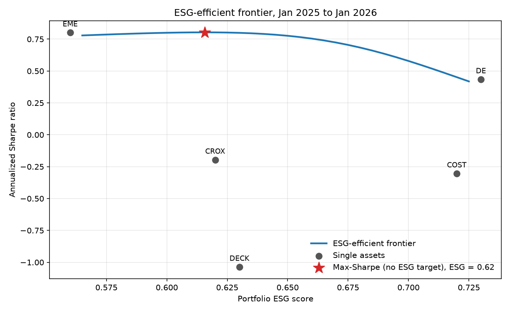
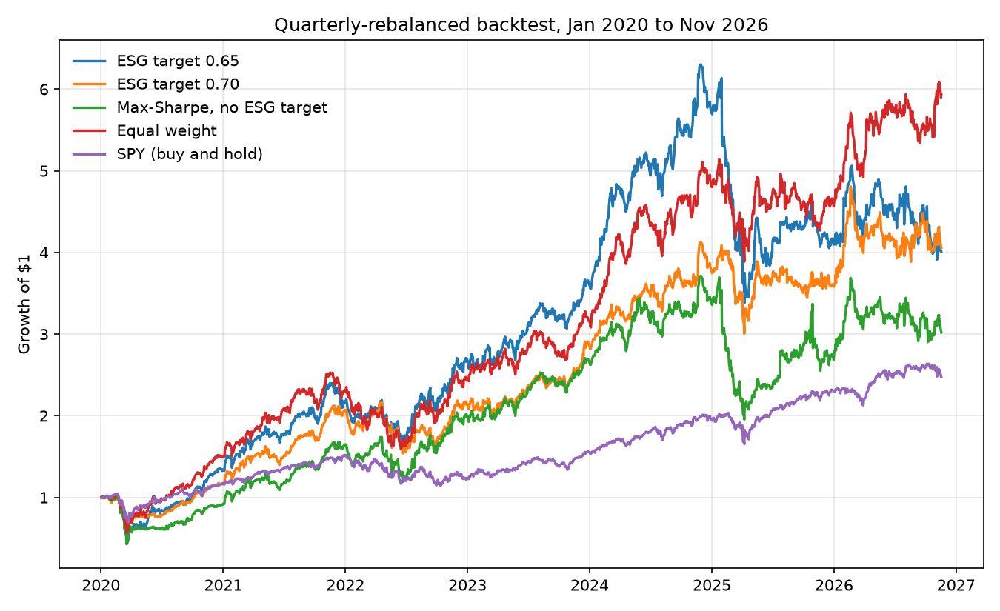
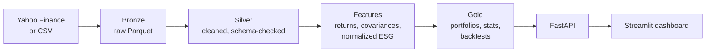

# ESG Portfolio Optimizer

[](https://github.com/ishaantibdewal/esg-portfolio-optimizer/actions/workflows/tests.yml)

ESG-aware portfolio construction for the Sustainable Investment Group (SIG), a student-run investment group at UC San Diego. The project answers one question for the fund: **how much risk-adjusted return do we give up to hold a portfolio with a higher ESG score?**

It has three parts:

- **Optimizer.** For each portfolio ESG target, find the long-only portfolio with the highest Sharpe ratio (SciPy, SLSQP). Sweeping the target traces an *ESG-efficient frontier*, which is compared with the unconstrained (Markowitz) maximum-Sharpe portfolio.
- **Data lake pipeline.** Price and ESG data move through bronze → silver → features → gold layers on MinIO/S3, with JSON schema contracts, Prefect orchestration and a backtesting engine.
- **API and dashboard.** A FastAPI service serves gold-layer results and runs live optimizations. A Streamlit dashboard lets you pick tickers, set ESG and allocation constraints, and see the frontier, weights, rolling Sharpe and a benchmark comparison.



On this five-stock universe the frontier is nearly flat from an ESG score of 0.56 to about 0.65: the fund can raise portfolio ESG that far at almost no cost in Sharpe ratio. Above 0.65 the cost rises quickly.

## Backtest

`research/esg_frontier_backtest.py` rebalances at the start of every quarter, estimating returns and covariances from the previous quarter only, so no future data leaks into a decision.



| Strategy (Jan 2020 to Nov 2026) | Annual return | Annual volatility | Sharpe | Max drawdown |
|:--|--:|--:|--:|--:|
| ESG target 0.65 | 22.4% | 32.1% | 0.70 | −57.9% |
| ESG target 0.70 | 22.6% | 26.2% | 0.80 | −41.6% |
| Max-Sharpe, no ESG target | 17.5% | 32.7% | 0.57 | −57.6% |
| Equal weight | 29.6% | 28.4% | 0.96 | −45.0% |
| SPY (buy and hold) | 14.1% | 20.0% | 0.62 | −33.7% |

What this shows, and what it doesn't:

- The ESG-0.70 portfolio had lower volatility and a much smaller worst drawdown than the unconstrained optimizer. The ESG target acted as a diversification constraint.
- Equal weight beat every optimized portfolio. This is a known result: with expected returns estimated from one quarter of data, estimation noise dominates mean-variance optimization ([DeMiguel, Garlappi and Uppal, 2009](https://doi.org/10.1093/rfs/hhm075)). Longer estimation windows or shrinkage estimators are the natural next step.
- Five stocks over one period, with no transaction costs, is a demonstration of the method, not evidence that ESG targets improve returns.

Full output: [docs/results.md](docs/results.md).

## Quick start

Requires Python 3.11 or newer.

```bash
python -m venv .venv && source .venv/bin/activate
pip install -r requirements.txt
```

**Research script** (needs only internet access for Yahoo Finance data):

```bash
python research/esg_frontier_backtest.py
python research/esg_frontier_backtest.py --tickers AAPL MSFT NVDA --esg-scores 0.70 0.80 0.60 --targets 0.72
```

**API and dashboard:**

```bash
cd frontend
uvicorn api:app --port 8000          # terminal 1
streamlit run esg_dashboard.py       # terminal 2, opens http://localhost:8501
```

**Full data lake pipeline** (needs Docker):

```bash
docker compose up -d minio
cp example.env .env && export $(grep -v '^#' .env | xargs)
python scripts/setup_minio.py                                   # create the lake bucket
python scripts/fetch_market_data.py --tickers AAPL MSFT GOOGL --days 252 --ingest
python -m src.orchestration.flow                               # ingest → features → optimize → backtest
```

The MinIO console runs at http://localhost:9001. The default credentials in `example.env` are for local development only.

## Tests

```bash
pytest
```

The tests cover the ESG optimizer, schema contracts, the pipeline and the API's gold-layer endpoints. Data-lake reads are stubbed, so MinIO is not needed. They run on every push via GitHub Actions.

## Architecture



```
frontend/      FastAPI service (api.py), Streamlit dashboard, optimizer module (esg_optimizer.py)
research/      Frontier and backtest script that produces the figures above
src/           Data lake pipeline: ingest, features, optimize, backtest, Prefect flow, schema contracts
scripts/       Data population, MinIO setup, AWS sync
tests/         pytest suite
docs/          Setup, MinIO, AWS sync and cloud deployment guides; figures and results
```

## Configuration

Set in `.env` (see `example.env`):

| Variable | Default | Meaning |
|:--|:--|:--|
| `S3_ENDPOINT` | `http://localhost:9000` | MinIO or S3 endpoint |
| `LAKE_BUCKET` | `lake` | Bucket for all lake layers |
| `COV_WINDOW_DAYS` | `20` | Covariance estimation window |
| `EXPECTED_RETURN_LOOKBACK` | `20` | Lookback for expected returns |
| `RISK_AVERSION` | `5.0` | Mean-variance risk aversion in the pipeline optimizer |
| `WEIGHT_CAP` | `0.07` | Maximum weight per asset |

More detail: [setup](docs/setup.md), [MinIO](docs/minio-setup.md), [frontend and API](docs/frontend-api.md), [AWS sync](docs/aws-sync.md), [cloud deployment](docs/cloud-deployment.md).

## Team

Built by SIG's R&D team at UC San Diego. This is a public copy of the team repository.

- [Ishaan Tibdewal](https://github.com/ishaantibdewal): led the project as Director of R&D; ESG optimizer, efficient-frontier research and backtest, Streamlit dashboard
- [jdamani-plus](https://github.com/jdamani-plus), [vaibhavmaloo03](https://github.com/vaibhavmaloo03): data lake pipeline, Docker, API endpoints
- [Jaivd](https://github.com/Jaivd): integrated the data lake and backtest work
- [BenZHashim](https://github.com/BenZHashim): FastAPI endpoint, pipeline results
- [Chrisc1124](https://github.com/Chrisc1124): dashboard polish
